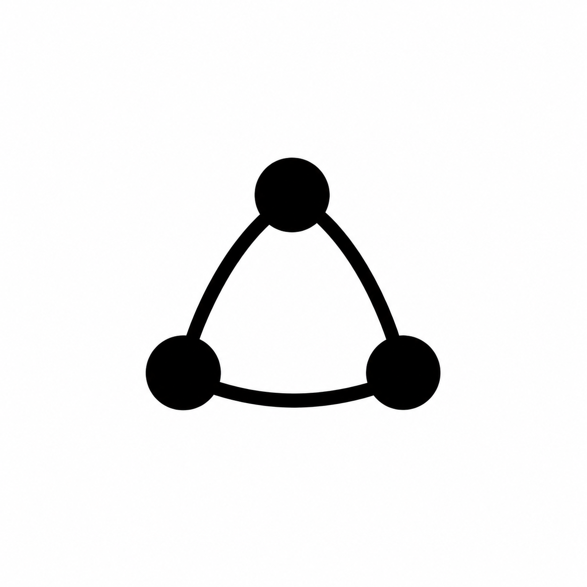

#  Ping

If Every great idea has the potential to change don't you think it deserves a place to not only be kept but be though-on and be shared with the world. I think so too, that's why I built PING




It's a high-performance web platform built for digital writers and researchers to write, organize, and catalog knowledge collections. Designed with a clean aesthetic user experience with robust architectural foundations.

---

## 🎨 The Inspiration

Ping was inspired by the need for a seamless, lightweight, and deeply aesthetic writing tool—free from the visual bloat of traditional document editors. Taking cues from modern, developer-centric interfaces like **Cursor AI** and **VS Code**, the workspace features independent scrolling panels, absolute color demarcations, and a distraction-free environment. 

Ping serves as an intuitive digital workbench where thoughts instantly translate into organized chapters, archives, and distributed public streams.

---

## 🏗️ Technical Stack

* **Framework:** Next.js (App Router, Client-Side Content Lifecycle Optimization)
* **Text Engine:** Tiptap Core (ProseMirror-backed asynchronous canvas editor)
* **Database & Auth:** Appwrite Cloud (Distributed User Management & Document Fabrics)
* **Styling:** TailwindCSS (Strict minimalist monochrome design token palette)
* **Icons:** Lucide React

---

## ⚙️ Engineering Principles & Process

The codebase is built on an architectural standard that guarantees rapid feature shipping without sacrificing maintainability.

### 🛡️ SOLID Design Implementation
* **Single Responsibility Principle (SRP):** Components are isolated modules. Core logic handles single data flows—like the `AuthCallbackPage` handling authentication tokens exclusively, passing routing states cleanly forward.
* **Open/Closed Principle (OCP):** Core modules are open to extension but closed to modification. For example, our custom Tiptap extension suite hooks seamlessly into default packages without modifying underlying editor code arrays.
* **Liskov Substitution Principle (LSP):** Object and parameter typing structures are predictable, meaning utility modules and database managers share cleanly polymorphic data payloads.
* **Interface Segregation Principle (ISP):** Client views receive only the narrow API datasets they require to render, preventing over-fetching anomalies.
* **Dependency Inversion Principle (DIP):** High-level page orchestrators depend strictly on abstractions (`@/lib/appwrite`) rather than raw, hardcoded endpoint strings, allowing fluid environment swapping.

### 📐 Structural Guidelines
* **KISS (Keep It Simple, Stupid):** Avoiding convoluted client abstractions. OAuth callbacks use native web states (`window.location.origin`) to seamlessly manage transitions without heavy environment management scripts.
* **DRY (Don't Repeat Yourself):** Asset pipeline endpoints, file upload bridges, and telemetry logic are consolidated entirely inside uniform helper utilities (`lib/appwrite.ts`) to avoid duplicate logic nodes.

---

## 🔁 Agile Development Methodology

Ping is engineered through adaptive, rapid-cycle execution:

* **Sprints:** Development is broken down into high-velocity micro-sprints focusing on critical product areas (Authentication Handshakes ➡️ Layout Optimization ➡️ Editor Integrity).
* **Feedback-Driven Iteration:** Early builds are continuously deployed and shared with users inside isolated beta loops to catch multi-device design or routing anomalies quickly.
* **Continuous Integration:** Utilizing GitHub-driven deployment pipelines directly to Vercel for instant automated compilation verifications and server builds.

---

## 🚀 Local Installation & Setup

1. **Clone the repository:**
   ```bash
   git clone [https://github.com/your-username/ping.git](https://github.com/your-username/ping.git)
   cd ping


## Getting Started

First, run the development server:

```bash
npm run dev
# or
yarn dev
# or
pnpm dev
# or
bun dev
```

Open [http://localhost:3000](http://localhost:3000) with your browser to see the result.


This project uses [`next/font`](https://nextjs.org/docs/app/building-your-application/optimizing/fonts) to automatically optimize and load [Geist](https://vercel.com/font), a new font family for Vercel.

